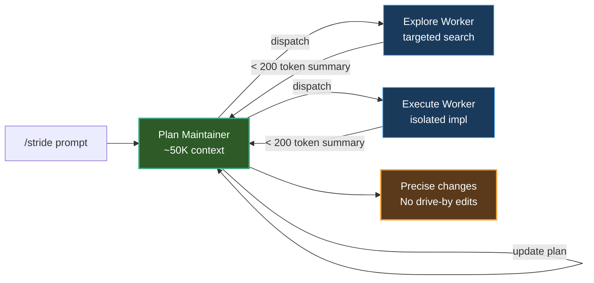

# 125K Context Is All You Need

**Your coding agent has a 1M context window. That's the problem, not the solution.**

A context management strategy for coding agents. Core finding: **controlling what's in your context matters more than how much context you have.** Implementation code in the main agent's context acts as an anchor — it makes the model imitate rather than innovate.

**52% faster. 55% fewer lines changed. Main agent stays at ~50K tokens no matter how many tasks.**

[English](README.md) | [中文](README_zh.md)

| **~50K 恒定主上下文** | **改动行数 -55%** | **耗时 -52%** | **轮次 -53%** | **MIT** | 双语 |
|:---:|:---:|:---:|:---:|:---:|:---:|
| 任务再多也不涨 | mimo vs Traditional | SWE-bench Lite A/B | sonnet 轮次减半 | 开源 | EN/中文 |

> **中文一句话**：给编码 Agent 的上下文管理策略——主 agent 锁在 ~50K，探索与实现全部丢给隔离 Worker，只收 200 token 以内的问题级摘要。不是少给你上下文，是决策时少让你看见。

**目录**：[Results](#results) · [Quick Start](#quick-start) · [Problem](#problem) · [Solution](#solution) · [Running Flow](#running-flow) · [Constraints](#constraints) · [Benchmarks & Reproducibility](#benchmarks--reproducibility) · [File Structure](#file-structure) · [Known Limitations](#known-limitations) · [Who is this for?](#who-is-this-for) · [License](#license)

---

## Results

A/B test on SWE-bench Lite, comparing Traditional vs Stride mode:

**mimo-v2.5-pro (1M context window):**

| | Time | Turns | Files Changed | Lines Changed |
|------|------|------|---------|---------|
| Traditional | 284.0s | 16.2 | 2.8 | 53 |
| **Stride** | **136.5s** | **14.0** | **1.7** | **24** |
| **Delta** | **-52%** | **-13%** | **-39%** | **-55%** |

**claude-sonnet-4-6 (200K context window):**

| | Time | Turns | Files Changed | Lines Changed |
|------|------|------|---------|---------|
| Traditional | 95.6s | 17.5 | 1.0 | 22 |
| **Stride** | **95.5s** | **8.3** | **1.0** | **17** |
| **Delta** | **-0.1%** | **-53%** | **0%** | **-23%** |

**Per-task breakdown (mimo):**

| Task | Traditional | Stride |
|------|------------|--------|
| astropy-12907 | 148s / 5t / 1 file / 14 lines | 124s / 11t / 1 file / 14 lines |
| django-10914 | 275s / 25t / **6 files** / **113 lines** | **209s / 17t / 3 files / 40 lines** |
| matplotlib-18869 | 212s / 20t / 2 files / 43 lines | **77s / 14t / 1 file / 18 lines** |

### Key Takeaways

**1. Stride makes weak models perform like strong ones.**
mimo under Stride (1.7 files / 24 lines) matches sonnet under Traditional (1.0 files / 22 lines) in precision — at a fraction of the cost.

**2. The mechanism is eliminating "while I'm at it" edits.**
django-10914 is the clearest example: Traditional touched 6 files / 113 lines, most of them unrelated files spotted during search. Stride's isolated context kept it to the 3 files / 40 lines that actually mattered.

**3. For strong models, Stride saves turns, not time.**
sonnet is already precise (1 file changed in both modes), but Stride cut turns from 17.5 to 8.3 (-53%) by eliminating unproductive exploration paths.

**4. Large context is a double-edged sword.**
mimo's 1M window lets the agent ingest the entire project. The result: the more it reads, the more it changes — but not all changes are warranted. Stride's value: **not limiting what the agent can read, but limiting what it can see when making decisions.**

---

## Quick Start

### Install

```bash
git clone https://github.com/SPA3K/stride-agent ~/.claude/skills/stride
# Auto-register in your project
echo -e '\n## Stride Mode\n\nFor multi-file changes or complex refactors, use Stride mode:\n- Read ~/.claude/skills/stride/SKILL.md and follow its rules strictly\n- Or prefix your prompt with /stride' >> CLAUDE.md
```

### Use

```
/stride Refactor the overflow detection in src/processor.cpp — the threshold is currently hardcoded
```

### What you get

- Agent decomposes into 3-5 steps first, instead of reading every file upfront
- Each step uses Explore workers for targeted search, Execute workers for isolated implementation
- Main agent context stays at ~50K tokens regardless of task count
- Changes are precise — no "drive-by" edits to unrelated files

### How it works



### Traditional vs Stride


---

## Problem

Standard coding agents work like this: read lots of files → dump everything into context → design and execute.

Four layers of problems:

### 1. Context Flooding

Agent reads 10 files, 10 code blocks enter context. Even if only 2 are used, the other 8 tokens stay permanently.

### 2. Linear Conversation Growth

Measured: a 358-turn session grew from 44K to 219K tokens. The growth driver isn't file content — it's each conversation turn itself.

### 3. Wrong Mental Model

Agents default to "research everything first → design once → execute." Humans actually work as "rough architecture → execute → hit problem → search → continue." Front-loading research causes goal drift and over-design.

### 4. Context Anchoring Effect (the core problem)

When the main agent's context is saturated with existing implementation code, the model's behavior degrades from "understand then innovate" to **"imitate existing patterns and generate similar code."**

This is the opposite of humans: people abstract higher-level understanding from reading code, then generate novel solutions from that abstraction. LLMs **lock onto existing patterns** and produce output that looks increasingly like what's already there.

> **Conservation law: you trade context for "correctness" (no silly mistakes), you lose "creativity" (no novel solutions).**

---

## Solution

### Plan Maintainer + Worker Isolation

The main agent becomes a **Plan Maintainer** — it only maintains plan accuracy and executability, never sinks into implementation details.

```
Traditional:
Main agent → read files → think → execute → read more → think → execute
            [everything piles up in one context, existing code becomes anchor]

Stride:
Main agent (Plan Maintainer) → maintain plan + TODO list
     ↓ dispatch
  Explore worker → investigate → return problem-level summary (< 200 tokens)
     ↓
  Execute worker → implement → return problem-level summary (< 200 tokens)
     ↓
  Main agent updates plan, repeat
```

### Context Quality Management

**Plan Maintainer CAN read:**
- Interfaces / header files (understand module boundaries)
- Diffs (review whether changes match design intent)
- pass/fail + first line of error

**Plan Maintainer MUST NOT read:**
- Full implementation bodies (anchoring risk)
- Step-by-step debug output (delegate to workers)

**Worker summaries report at the problem level only:**
```
✅ "Redundant data transformation between module X and Y, eliminated"
❌ "Changed processData in foo.cpp to use pipeline pattern"
```

Implementation-level descriptions anchor the Plan Maintainer's thinking, biasing future plans toward similar concrete solutions.

### Main Agent Context (constant ~50K)

| Component | Tokens |
|-----------|--------|
| System prompt (harness-fixed) | ~44K |
| TODO list (30 items) | ~1K |
| Reference file INDEX | ~0.5K |
| Current task context | ~1K |
| Interface-level info (on demand) | ~3K |
| **Total** | **~49.5K** |

Does not grow with task count. Compare: traditional mode hits ~219K at 100 turns.

### TODO List Lifecycle

```
[PENDING]    Coarse task description (~30 tokens)
[IN_PROGRESS] Detailed subtask + context (~50-100 tokens)
[COMPLETED]  One-sentence summary (~10 tokens)
```

Cap: 30 items. Near limit: compress completed (merge 3-5 into one line), expand pending (decompose into subtasks).

### Reference Files

Workers share knowledge via reference files. Plan Maintainer reads only the INDEX; downstream workers read BODY sections on demand.

---

## Running Flow

1. **Phase 0** — Coarse decomposition (doesn't need to be accurate, refined later)
2. **Phase 0.5** — Dynamic task correction (throughout)
3. **Phase 1** — Explore (on-demand, isolated)
4. **Phase 2** — Execute (code changes, isolated)
5. **Phase 3** — Verify (testing, isolated)

---

## Constraints

**Plan Maintainer:** Never read full implementations. Never store file content in TODO. Never accept implementation-level descriptions from workers. Never run tests directly.

**Workers:** Never return full file content. Never return >500 tokens. Never modify files outside task scope. Never describe specific implementation approaches in summaries.

---

## Benchmarks & Reproducibility

Every number in this README is transcribed into [`benchmarks/raw_results.json`](benchmarks/raw_results.json) — aggregates, per-task rows, and the meta that says what they are:

- **Protocol**: SWE-bench Lite 3-task subset (astropy-12907 / django-10914 / matplotlib-18869), Traditional vs Stride under the same harness; wall time, turns, `git diff --numstat` file/line counts.
- **Honest scope**: this is a **single-run A/B snapshot**, not multi-seed statistics. One known discrepancy is flagged in `meta.scope_note` (mimo-traditional aggregate 284.0s vs 211.7s mean of the 3 listed tasks — aggregates likely cover a wider run than the breakdown).
- **Reproduce**: harness scripts are the next release; until then, treat the tables as raw observations with a published protocol, not as a benchmark leaderboard entry.

> 可复现性是一个逐步逼近的承诺，不是一个布尔值——先公开数据与口径，脚本随后。

## File Structure

```
stride/
├── README.md                ← This file
├── SKILL.md                 ← Claude Code skill entry point (/stride)
├── agents/
│   ├── stride-pm.md         ← Plan Maintainer role definition
│   └── stride-worker.md     ← Worker role definition
└── prompts/
    ├── explore-brief.md     ← Explore worker prompt template
    └── execute-brief.md     ← Execute worker prompt template
```

---

## Known Limitations

1. **Workers can't recurse** — platform constraint; complex tasks need manual decomposition
2. **Dispatch overhead** — each subtask adds at least one Agent round
3. **Summary fidelity** — worker summaries may omit critical details
4. **Problem vs implementation boundary** — fuzzy in practice, requires worker judgment

---

## Who is this for?

| If you are... | Stride helps you... |
|---------------|---------------------|
| Using Claude Code / Cursor / Copilot for multi-file refactors | Get precise changes without "drive-by" edits |
| Paying per token on large context models | Cut context usage by 50%+ while improving output quality |
| Working with weaker/cheaper models | Get sonnet-level precision at mimo-level cost |
| Building coding agent systems | Adopt a proven context management pattern |

---

## Community

- Found a bug? [Open an issue](../../issues)
- Have a question? Start a [discussion](../../discussions)
- Like the project? Star it to help others find it

---

## License

MIT
