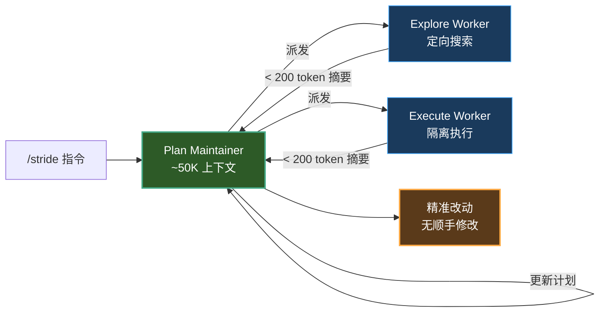

# 125K Context Is All You Need

**你的 coding agent 有 1M context window。这恰恰是问题所在，不是解决方案。**

Coding agent 上下文管理策略。核心发现：**控制上下文内容比控制上下文大小更重要**。实现代码进入主 agent 的 context 本身就是一种污染——它锚定思维，让模型只会模仿而不会创新。

**快 52%，少改 55% 行代码。主 agent 上下文恒定 ~50K token，不随任务数增长。**

[English](README.md) | **中文**

[](https://github.com/SPA3K/stride-agent/actions/workflows/docs.yml)

| **~50K 恒定主上下文** | **改动行数 -55%** | **耗时 -52%** | **轮次 -53%** | **MIT** | 双语 |
|:---:|:---:|:---:|:---:|:---:|:---:|
| 任务再多也不涨 | mimo vs Traditional | SWE-bench Lite A/B | sonnet 轮次减半 | 开源 | EN/中文 |

**目录**：[测试结果](#测试结果) · [快速开始](#快速开始) · [问题](#问题) · [方案](#方案) · [运行流程](#运行流程) · [约束](#约束) · [基准与可复现](#基准与可复现) · [文件结构](#文件结构) · [已知限制](#已知限制) · [适用场景](#适用场景) · [开源协议](#开源协议)

---

## 测试结果

SWE-bench Lite A/B 测试，对比 Traditional 和 Stride 两种模式：

**mimo-v2.5-pro（1M context window）：**

| | 时间 | 轮次 | 改动文件 | 改动行数 |
|------|------|------|---------|---------|
| Traditional | 284.0s | 16.2 | 2.8 | 53 |
| **Stride** | **136.5s** | **14.0** | **1.7** | **24** |
| **变化** | **-52%** | **-13%** | **-39%** | **-55%** |

**claude-sonnet-4-6（200K context window）：**

| | 时间 | 轮次 | 改动文件 | 改动行数 |
|------|------|------|---------|---------|
| Traditional | 95.6s | 17.5 | 1.0 | 22 |
| **Stride** | **95.5s** | **8.3** | **1.0** | **17** |
| **变化** | **-0.1%** | **-53%** | **0%** | **-23%** |

**逐任务明细（mimo）：**

| 任务 | Traditional | Stride |
|------|------------|--------|
| astropy-12907 | 148s / 5t / 1 file / 14 lines | 124s / 11t / 1 file / 14 lines |
| django-10914 | 275s / 25t / **6 files** / **113 lines** | **209s / 17t / 3 files / 40 lines** |
| matplotlib-18869 | 212s / 20t / 2 files / 43 lines | **77s / 14t / 1 file / 18 lines** |

### 结论

**1. Stride 让弱模型的产出质量接近强模型。**
mimo 在 Stride 模式下的改动精准度（1.7 files / 24 lines）接近 sonnet Traditional（1.0 files / 22 lines），但 mimo 的成本远低于 sonnet。

**2. 改动范围缩小的核心原因是消除了"顺手改"行为。**
django-10914 最典型：Traditional 模式下 agent 改了 6 个文件 113 行，其中大部分是搜索过程中"顺手"修改的不相关文件。Stride 通过隔离搜索上下文，让 agent 只改真正需要改的 3 个文件 40 行。

**3. Stride 对强模型的价值是省轮次，不是省时间。**
sonnet 本身已经很精准（改动文件数 = 1），但 Stride 把轮次从 17.5 降到 8.3（-53%），说明"先规划再执行"减少了无效探索路径。

**4. 大上下文是双刃剑。**
mimo 有 1M context window，agent 可以把整个项目读进上下文。结果是：读得越多，改得越多——但改的不都是该改的。Stride 的价值在于：**不是限制 agent 能读什么，而是限制 agent 在做决策时能看到什么。**

---

## 快速开始

### 安装

**方式 A · Claude Code 插件（推荐）：**

```
/plugin marketplace add SPA3K/stride-agent
/plugin install stride@stride-agent
```

**方式 B · npm —— 一条命令，安装器自动拷贝技能并注册：**

```bash
npm install -g github:SPA3K/stride-agent && stride-install
```

**方式 C · git clone（手动）：**

```bash
git clone https://github.com/SPA3K/stride-agent ~/.claude/skills/stride
# 自动注册到项目配置
echo -e '\n## Stride Mode\n\n当任务涉及多文件修改或复杂重构时，使用 Stride 模式：\n- 读取 ~/.claude/skills/stride/SKILL.md 并严格遵守其中的规则\n- 或在 prompt 前加 /stride 前缀' >> CLAUDE.md
```

> `stride-install` 幂等：把 `SKILL.md` + `agents/` + `prompts/` 拷进 `~/.claude/skills/stride`，并保证 `CLAUDE.md` 里的 Stride Mode 块只追加一次。参数：`--dry-run` · `--target <目录>` · `--claude-md <文件>`；每次 push，CI 都会跑它的自检（`npm test`）。

### 使用

```
/stride 帮我重构 src/processor.cpp 中的 overflow 检测逻辑，当前阈值是硬编码的
```

### 效果

- agent 先做粗架构分解（3-5 步），而不是先读完所有文件
- 每步通过 Explore worker 按需搜索，Execute worker 隔离执行
- 主 agent 上下文保持在 ~50K token，不随任务数增长
- 改动范围更精准，不会"顺手"修改不相关文件

### 工作原理



### Traditional vs Stride 对比


---

## 问题

标准 coding agent 的工作方式：大量读取文件 → 把所有结果堆入上下文 → 开始设计和执行。

### 1. Context Flooding

Agent 读 10 个文件，10 段代码进入上下文，即使只用了 2 个，另外 8 个的 token 也永久占位。

### 2. 对话历史线性增长

实测一个 358 轮会话从 44K 涨到 219K token。增量主体不是文件内容，是每轮对话本身。

### 3. 认知模型错误

Agent 默认"先全面调研 → 再一次性设计 → 最后执行"，但人的实际模式是"粗架构 → 执行 → 遇到问题 → 搜索 → 继续"。

### 4. Context 锚定效应（核心问题）

当主 agent 的 context 堆满已有实现代码，模型行为从"理解后创新"退化为**"模仿已有 pattern 生成类似代码"**。

> **守恒定律：你用 context 换来了"正确性"（不会犯低级错），就失去了"创造力"（不会产出新方案）。**

---

## 方案

### Plan Maintainer + Worker 隔离

主 agent 定位为 **Plan Maintainer**——只维护 plan 的准确性和可执行性，不沉入实现细节。

```
传统模式:
主 agent → 读文件 → 思考 → 执行 → 读更多文件 → 思考 → 执行

Stride 模式:
主 agent (Plan Maintainer) → 维护 plan + TODO list
     ↓ 派发
  Explore worker → 调研 → 返回问题层摘要 (< 200 tokens)
     ↓
  Execute worker → 执行 → 返回问题层摘要 (< 200 tokens)
     ↓
  主 agent 更新 plan，重复
```

### Context 质量管理

**Plan Maintainer 可以读的：**
- ✅ 接口/头文件（理解模块边界）
- ✅ diff（review 改动是否符合设计意图）
- ✅ pass/fail + 首行 error

**Plan Maintainer 不应该读的：**
- ❌ 完整实现（会被锚定）
- ❌ 逐行调试（交给 worker）

**Worker 摘要只报告问题层：**
```
✅ "模块 X 的数据流存在冗余转换，已精简"
❌ "在 foo.cpp 里把 processData 函数改成了 pipeline 模式"
```

### 主 agent 上下文（恒定 ~50K）

| 组成部分 | Token |
|----------|-------|
| 系统提示 | ~44K |
| TODO list | ~1K |
| Reference file INDEX | ~0.5K |
| 当前任务上下文 | ~1K |
| 接口层信息 | ~3K |
| **合计** | **~49.5K** |

不随任务数增长。对比传统模式 100 轮任务的 ~219K。

### TODO List 生命周期

```
[待执行] 粗任务描述（~30 token）
[执行中] 详细子任务（~50-100 token）
[已完成] 一句话摘要（~10 token）
```

### Reference File

Worker 间通过 reference file 传递知识。Plan Maintainer 只读 INDEX，后续 worker 按需读取 BODY。

---

## 运行流程

1. **Phase 0** — 粗架构分解（不需要精确，后续修正）
2. **Phase 0.5** — 动态任务修正（贯穿全程）
3. **Phase 1** — Explore（按需探索，隔离执行）
4. **Phase 2** — Execute（代码修改，隔离执行）
5. **Phase 3** — Verify（验证，隔离执行）

---

## 约束

**Plan Maintainer：** 不读完整实现，不把文件内容存入 TODO，不把实现层描述纳入 plan，不直接运行测试。

**Worker：** 不返回完整文件内容，不返回超过 500 token 的结果，不修改范围外的文件，不在摘要中描述具体实现方案。

---

## 基准与可复现

README 中每个数字都已转录进 [`benchmarks/raw_results.json`](benchmarks/raw_results.json)——汇总行、逐任务行、以及说明它们是什么的 meta：

- **协议**：SWE-bench Lite 三任务子集（astropy-12907 / django-10914 / matplotlib-18869），同一 harness 下 Traditional vs Stride；墙钟耗时、轮次、`git diff --numstat` 文件/行数。
- **诚实口径**：这是**单次 A/B 快照**，不是多种子统计。一处已知不一致标注在 `meta.scope_note`（mimo 汇总 284.0s vs 所列 3 任务均值 211.7s——汇总可能覆盖比分项更宽的运行范围）。
- **复现**：harness 脚本是下一个发布项；在那之前，请把表格当作「协议已公开的原始观测」，而不是榜单成绩。

> 可复现性是逐步逼近的承诺，不是布尔值——先公开数据与口径，脚本随后。

## 文件结构

```
stride/
├── README.md                ← 本文件
├── SKILL.md                 ← Claude Code skill 入口
├── agents/
│   ├── stride-pm.md         ← Plan Maintainer 角色定义
│   └── stride-worker.md     ← Worker 角色定义
└── prompts/
    ├── explore-brief.md     ← Explore worker prompt 模板
    └── execute-brief.md     ← Execute worker prompt 模板
```

---

## 已知限制

1. Worker 不能递归（平台约束）
2. 每个子任务至少多一轮 Agent 调用（简单任务有额外开销）
3. Worker 摘要可能遗漏关键信息
4. 问题层 vs 实现层边界模糊

---

## 适用场景

| 你的身份 | Stride 能帮你... |
|----------|-----------------|
| 使用 Claude Code / Cursor / Copilot 做多文件重构 | 精准改动，杜绝"顺手改" |
| 按 token 付费的大上下文模型用户 | 上下文用量降低 50%+，输出质量反而提升 |
| 使用较弱/较便宜的模型 | 用 mimo 的成本获得 sonnet 级别的精准度 |
| 构建 coding agent 系统 | 采纳成熟的上下文管理模式 |

---

## 社区

- 发现 bug？[提 Issue](../../issues)
- 有问题？发起 [讨论](../../discussions)
- 觉得有用？Star 一下，让更多人看到

---

## 开源协议

MIT
